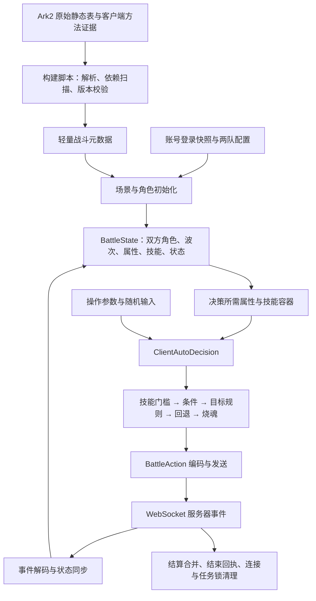

# 虚构深渊：客户端自动决策复刻架构

分析日期：2026-10-12。范围为 LucimaTools 深渊 WebSocket 执行器、最新完整抓包、Ark2 当前静态表，以及 Ark2 保存的 IL2CPP 元数据和恢复方法体。

后续已进入实现阶段，实际改动、回放结果及剩余缺口见 [迁移记录](abyss-implementation.md)。以下内容保留为架构与原生证据分析，实施状态以迁移记录为准。

## 结论与复刻目标

可以以客户端自动决策的语义等价为目标重构。入口、规则来源、技能门槛、条件、候选目标、回退、烧魂和状态同步都有可追踪的实现依据，所需数据也有明确来源。当前实现的主要障碍是状态和元数据不完整，以及把多层客户端逻辑压缩成了几个简化判断。

不过，当前证据尚不足以宣布“线上所有角色已经能 100% 复刻”。需要完成决策依赖的属性合成、目标类型及条件闭包迁移，并核对当前客户端版本。恢复方法体来自 0513 APK 系列；当前表为 catalog 115309，不能用新表更新代替新版本方法体核验。

“完整效果”的验收定义应为：同一版本、同一战斗状态、同一操作参数和同一随机输入下，选择相同技能、目标与烧魂；独立实战中遵循相同候选集合和随机概率。原客户端每次随机调用会创建新 GUID 并初始化 `System.Random`，独立运行自然可能选到不同目标，不能要求两场独立战斗逐包相同或必然同一胜负。

本轮完成分析与证据整理，没有改动战斗业务代码，也没有向游戏服务器提交行动。

## 总体架构



服务器返回的生命、资源、状态、冷却和行动条进入同步层。本地负责重建决策会读取的属性，并选择下一项操作。普通伤害、暴击、闪避、连击结果和胜负仍通过服务器战斗过程获得；是否需要额外的本地状态处理，以客户端同步与决策依赖的审计结果为准。

建议将现有 `backend/abyss_battle.py` 拆成下列职责。这些是拟议模块，还未创建或接入：

| 模块 | 职责 | 输入/输出 |
|---|---|---|
| `battle_metadata` | 读取已解析的场景、AI、技能、状态和属性定义，检查版本与引用 | 静态定义与能力清单 |
| `battle_initialize` | 选当前活动配置，构造两队、怪物、初始技能与状态 | 快照、场景、配置 → `BattleState` |
| `battle_state` | 保存战斗实例和按顺序应用服务器事件 | 解码结果 → 最新状态 |
| `battle_properties` | 合成决策用属性、技能形态和能力标志 | 状态与静态定义 → 属性查询 |
| `battle_conditions` | 解释客户端条件表达式，保留作用对象、量词、比较及组合 | 条件与上下文 → 判断及原因 |
| `battle_targets` | 按客户端规则构造和筛选候选集合 | 选择器与上下文 → 有序候选 |
| `battle_auto_decision` | 执行 `ProcessAI/CreateAction`，产生技能、目标及烧魂选择 | 状态、操作参数、随机输入 → `Decision` |
| `abyss_battle` | 建房、握手、行动窗口、发送、推进超时、中止和结束 | 决策 → WebSocket 行动 |
| 现有账号响应合并层 | 合并 `SceneRewardData`，通知页面更新 | 结算 → 账号缓存 |

决策层不直接发请求，不读取未来消息，便于用同一份代码做离线比对和实际运行。运行状态和待确认行动按战斗实例隔离，不能跨账号共用可变状态。

## 构建时的数据边界

当前两个元数据文件大小约为 207 KiB 和 854 KiB，合计约 1.04 MiB。这是现有文件大小，不是新架构的最终包体预测。新增必要字段后再测量；反汇编、APK、原生库及 Unity 资源只用于分析，不加入运行包。

| 数据 | 对决策的用途 | 导出方式 |
|---|---|---|
| `sd_Role` | 英雄与怪物基础定义、元素、职业、技能与 AI 引用 | 保留所有可达角色，不能只有正式英雄索引 |
| `sd_AIAction` | 优先级、技能索引、条件和目标规则 | 同一 ID 多行构成规则列表，保持来源顺序 |
| `sd_Scene`、`sd_Fantasy` | 前置关卡、波次怪物、首领标志、活动配置和关卡状态 | 场景 ID → 配置列表，再按活动选配置 |
| `sd_Status` | Buff/Debuff 类型、属性、叠层、数值和同步后的能力标志 | 解析实际字段，不依赖状态名称前缀 |
| `sd_Skill`、`sd_SkillLevel` | 技能选择、SP、冷却、烧魂、等级属性、被动、形态及选择限制 | 基础定义 + 按技能/等级的增量 |
| `sd_RoleProperty`、`sd_RoleAwaken`、`sd_RoleImprint` | 生命上限、攻击等基础和成长属性 | 保留对应等级、觉醒阶段及记忆烙印结构 |
| `sd_Equipment`、`sd_EquipmentSet`、`sd_Artifact` | 装备、套装和神器对决策属性及被动的影响 | 配合账号实例数据解析 |
| `sd_Activity`、`sd_PublicVariable` | 活动开放例外、常量及默认值 | 仅导出可达定义 |
| 账号快照 | 实际等级、技能等级、装备词条、神器、觉醒、烙印与活动时间 | 战斗开始时取得所属账号的一致快照 |

当前静态表有 1,873 个角色定义、1,926 个技能、563 个状态。`sd_AIAction` 有 353 行、125 个 ID；`sd_Fantasy` 有 214 行、10 个场景 ID。不能通用套用现有 `load_table()` 的“每个 ID 唯一”规则；它适用于已有 Role/Skill 导出，扩展到 AI/Fantasy 会拒绝或丢失合法记录。SkillLevel 的键为 `SkillID/LV`，RoleAwaken 为 `RoleID/LV`，RoleProperty 也需要保留等级维度。

构建阶段应从英雄、场景怪物、状态与技能属性中的引用遍历可达定义，包括动态 `AI`、`TauntAI` 和替换技能。为条件类型、目标类型、属性和表达式生成覆盖清单。遇到未支持的可达语义应明确报告；不能默默视为条件成立、忽略字段或降级为随机攻击。

DSL 应复用 Ark2 已有的原始表解析方式，保留原始键、默认值和有序列表，不从图鉴翻译文案反推执行逻辑。当前 Role 表部分非消费文本存在编码异常；导出时继续核验实际消费字段，不能静默替换决策字段中的损坏字符。

## 深渊场景初始化：已找到敌人的正式来源

`sd_Scene` 中空的怪物波次不代表缺少怪物数据。客户端由 Fantasy 定义解析两队怪物及关卡状态，并写入场景波次容器，再调用战斗初始化。

已确认的调用关系：

```text
FantasyStaticData.InitStaticDatas
  → 按场景 ID 保存有序 Fantasy 配置列表
FantasyStaticData.GetStaticData(sceneID, activityContainer)
  → 按原列表顺序 Find 首个 ActivityIDList 全部开放的配置
FantasyStaticData.Init
  → 解析 WaveMonsterJson1/2、WaveBuffJson1/2，关联 Scene 波次
BattleData.StartBattle / ProcessStartPVEWave
  → BattleRoleContainer.InitPVENewWave
  → InitWaveMonster、角色初始化、关卡状态和行动条初始化
```

注意两个活动方法用途不同：`GetStaticData` 选择某场景的具体配置；`GetNowOpenActivity` 收集 Fantasy 活动 ID 并查找未过期设置，不能用后者替代前者。

`ActivityDBSettingContainer.IsActivityListOpen` 的列表语义为全部满足。单个 `IsActivityOpen` 还允许空 ID、默认开放 ID、静态忽略时间等例外；普通设置按 `IsExpired` 及客户端时间判断。周期活动需要通过 `ActivityStartTime/ActivityEndTime` 计算实际窗口，不能直接判断旧的原始 EndTime 已经过期。

最新抓包登录响应时间为 `Utc=1791633042`。其中第一至六关活动 `Version_Fantasy01_1-6` 和 `Fantasy_H189` 均在有效期内。当前表中可对应选出 10 个场景配置：前六关各一行，后四关各有 52 期配置，当前匹配 `Fantasy_H189`。

例如第八关当前上半怪物为 `FH057`，下半为 `FH029`；第十关为 `FH022`、`FH123`，均带 Boss 标志。当前配置的下半 `FG_Special_031` 作用于 Enemy，与抓包中下半敌人的同步状态吻合。怪物属性与所有关卡状态的完整数值仍需通过初始化链逐项验收，不能把这一处吻合当成全部初始化已验证。

场景配置还可能包含多个怪物位置，历史配置存在额外 `Pos:5`；不能固定假定只有一个敌人。`M/Pos/Boss` 之外的覆盖属性、等级、AI 和初始状态也要保留。战斗编号按客户端阵营、波次和位置生成，并与服务器编号核对。

`RoleTimeMap` 可用于核对已存在角色和新角色线索，但不提供完整静态身份或属性。当前用 `PreEnemyCount` 生成第二阵营成员的逻辑应被正式初始化替代；该字段表示行动来源的对方人数，不能无条件解释为第二阵营人数。

## 战斗状态与同步契约

建议显式维护以下状态，而不是所有信息都放进无类型的单位字典：

| 状态 | 来源与更新规则 |
|---|---|
| 场景、活动配置、波次和角色编号 | 初始化 + 服务器换波次/新增角色事件 |
| 当前行动者、Round、DisplayRound、Step | 服务器 RoundResult 与步骤消息 |
| 当前生命、SP、死亡退场、伤痕、角色行动条 | 可信角色同步事件；行动条还来自 RoleTimeMap |
| 当前状态列表 | 可信事件 NowStatusList，保留 StaticID、Value、NowStack、SourceRoleID、UntilRound 等 |
| 当前冷却映射 | 可信事件 NowSkillCooldownMap，空集合必须替换旧集合 |
| 生命上限、攻击、元素、首领、能力标志 | 静态与快照初始化，再按状态/临场属性重算 |
| 当前技能容器和等级 | 账号技能实例 + 替换技能属性与客户端获取顺序 |
| 阵营灵魂值 | RoundResult.CampSoulList 及正式同步路径 |
| 待确认行动与会话阶段 | 本地协议执行器，不混入游戏属性 |

原生顺序是先 `BattleRoundResult.ApplyBattleData`，再依据 Step 分派：Step 5 重算全部角色能力，Step 8 换波次，其他路径按行动结果处理事件。不要先选技，再补同步同一帧中的冷却和状态。

`BattleRoleData.SyncEvent` 受 `IsCanSyncRole` 控制：同步生命、SP、伤痕、行动条、回合、死亡等，再同步状态、清空并复制当前冷却映射，最后 `ResetData` 重算能力。

本轮补查了构造器：`BattleRoleEvent` 会创建空的 `NowSkillCooldownMap` 和 `NowStatusList`。因此 JSON 省略这些集合时，可信角色同步仍应恢复为空；`BattleStatusContainer.SyncStatusListByEvent` 也是先清空再复制。缺字段保留旧值会同时造成冷却和状态残留。心跳、展示事件、非可信事件不使用这套清空规则。显式 null 及消息类型默认值应在解码层单独验证。

`NewStatusList/UpdateStatusList/RemoveStatusList` 用于事件过程，不能在已有完整 NowStatusList 同步后再次叠加。`UpdateSkillList` 是否表示换形态由事件类型决定；本抓包中的 21 条是 `ReSetSkillCoolDown`，不能当成替换技能容器。

## 决策用属性合成

这部分是达到完整复刻的主要工作量。只补 Status.IsBuffType 或 HP 比例仍不足够。

已找到的主链：

```text
RoleData.CreateRolePropertySetting
  → CreateRoleBasePropertySetting
  → 装备/套装、神器可用性与属性
  → 自身烙印与觉醒属性
AbilityData.Reset
  → 上述角色属性
  → 战斗额外属性
  → 当前状态的 PropertySetting
  → 回调提供的技能被动、光环等临场属性
  → ResetTempValue / CreateFinalValuePropertySetting
BattleRoleData.ResetData / GetRoleRuntimeProperty
  → 为通常查询或特定上下文重算能力
```

`StatusData.get_PropertySetting` 根据状态定义决定是否按层数和 Value 乘算。状态不能仅按名称识别，也不能把所有 Value 都当成百分比。生命比例读取 `NowHP / 当前 Ability.HP`，不是最大已观测生命值。当前“见过最高的 HP 就当 MaxHP”会在敌人首次同步已受伤时产生错误。

技能列表 `BattleSkillContainer.GetAllSkills` 会先读运行时替换技能属性，再回落到账号技能列表。`GetSkillByIndex` 使用该列表顺序，负索引有取最后技能的分支，越界正索引返回空。不能按技能 ID 后缀重新排序。具体属性合并次序、取整与混合 float/double 行为需要依方法保留。

建议按决策读取的属性做依赖闭包迁移：生命、攻击、速度、元素/身份、技能可用性、AI 覆盖、状态类型/数量/层数、行动条等，再纳入其来源的被动、光环与转换器。DSL 中引用其他属性时继续扩展闭包，不能只导出五个显眼字段就宣称等价。

不需要为了选技重演每个攻击动画或所有伤害随机过程。但必须审计服务器未直接同步、而下一次决策仍会读取的临场状态；此类路径若存在，仍要迁移，不能以“服务器算伤害”为理由跳过。

## 客户端一次行动的顺序

入口为 `AIProcessor.StartAIAction → ProcessAI`。操作参数为 `AIProcessParam`：`TargetID`、`UseSkillIndex`、`IsDoubleClick`、`IsUseSoulIfCan`。构造器默认 `UseSkillIndex=-1`；自动流程与手动指定技能/目标需要明确区分。

1. 取得服务器指定的当前行动角色，建立 `SkillProcessContext` 与 `SkillFunctionParam`。
2. 若被嘲讽，先尝试当前属性的 `TauntAI`。失败时走嘲讽普攻目标路径，其中显式允许隐身、无敌。
3. 通常 AI 来源优先级为：运行时 `AI` 属性覆盖 → 场景怪物 AIs 覆盖 → 角色静态 AIs。
4. 将规则按 Priority 稳定降序排列，同优先级保留来源顺序。
5. 指定技能时先筛选该 SkillIndex 的规则；`IsDoubleClick` 还存在强制指定技能回退分支。纯自动参数使用全部规则。
6. 每条规则调用 `CreateAction`：取当前技能、检查 CanUseSkill、克隆上下文、逐条检查顶层 Conditions，然后寻找目标。
7. 首个成功规则立即返回，不在所有可用技能之间重新打分。
8. 全部规则失败后走客户端普攻回退。先尝试仍合法的指定目标，再用客户端备用评分；评分以当前生命为基础，再叠加正逆克制、无敌和隐身的权重，不能替换成“敌人数组第一个”。
9. 将选择转换为 BattleAction；只有 `IsUseSoulIfCan` 开启且选中技能满足 CanUseSoulSkill，才设置烧魂。

这条链说明抓包中的烧魂和指定技能不能直接作为纯自动 AI 的标准答案。此前观察到的 5 次烧魂，需要结合该场操作参数判断；不能一概解释为客户端自动策略与程序有误。

### 能否行动、能否用技能与能否控制目标

三个原生能力不能合并成一个状态黑名单：

| 判断 | 已核对语义 |
|---|---|
| `WillPassRound` | 眩晕、睡眠或 HideOut 会进入跳过回合状态 |
| `CanUseSkill` | 嘲讽、睡眠、沉默阻挡通常技能；技能容器另有普攻例外 |
| `CanControlRoleAction` | 嘲讽、眩晕、睡眠或 HideOut 时不能通常控制角色目标 |

`BattleSkillContainer.CanUseSkill` 在通常路径检查：SP 为负时资源是否够用、当前冷却不大于零、`GetAllCampCanTargetRoles` 非空。能力禁止通常技能时走 NormalSkill ID 比对的独立分支。不能把不同分支统一成无条件相同的门槛。

烧魂路径检查选中技能是否为 SoulSkill、CanUseSkill、`NoSoulCost` 属性或阵营灵魂值是否达到该技能静态要求。现在执行器固定发送 `IsUseSoul=0`，应改成明确的操作设置与上述契约。

### 条件表达式

`SkillCondition.Check` 包含作用对象、集合、属性、CheckFun 与组合判断。应保留 `Who`、`TargetInfo`、`RoleSelectInfo`、`IsAllWhoPass`、`ComparedValue`、`Conditions`、`NextCondition`、`Invert` 及默认值，按原方法顺序解释。

已确定的比较符如下，名称含义不能按通常命名习惯重写：

| 原字段 | 实际比较 |
|---|---|
| Eq | 等于 Value |
| Ne | 不等于 Value |
| Lt | 小于或等于 |
| Gt | 大于或等于 |
| Ltn | 严格小于 |
| Gtn | 严格大于 |
| Between | 两端取 min/max 的闭区间 |

Value2 只在对应范围比较中使用，不能让 Eq/Ne 自动变成区间。本轮离线对照当前 `_compare`：四个大小比较在相等边界均不符，Eq/Ne 携带 Value2 时也不符，共六个明确差异样例。

集合条件默认“任一满足”；`IsAllWhoPass=true` 时为“全部满足”，空集合在已核对路径提前失败。H174 的条件涉及“存在其他队友无减益”，并不要求最终技能目标无减益。`AllyCount` 包含自己且只计存活队友；`DeBuffCount/DebuffCount` 应按客户端大小写解析契约处理。

目前 226 个正式角色展开后共 574 条 AI 规则，直接出现 5 种 CheckFun、13 种目标策略，覆盖范围并非无限。但这个统计只覆盖当前英雄静态 AIs，不能代替技能选择限制、怪物、TauntAI 和状态覆盖 AI 的完整依赖扫描。

### 目标选择与回退

候选选择器由 `SkillSelectInfo.CreateBySkillParam` 创建：使用技能的 TargetCamp 与 AI 设置的 Type；NoSelf 为技能和 AI 两者的合并。AI 候选目标类型与技能最终作用范围不是同一概念，例如一个全体攻击仍需要按 AI 规则选一个提交目标。

`CreateAction` 在顶层条件通过后存在已核对的三遍目标搜索：

```text
第一遍：按 TargetSettings 顺序创建普通选择器并尝试
第二遍：重新创建每个选择器，仅强制 IncludeInvincible=true
第三遍：重新创建每个选择器，仅强制 IncludeStealth=true
```

第二、三遍不是累积打开两项。每个选择器还保留自身设置的 Include 标志；不能用“候选为空就全放开”替代。

在此之前，敌方技能存在复用指定 TargetID 的路径，但要求角色能够控制行动、目标仍存活且没有 HideOut/Stealth。`GetAllCampCanTargetRoles` 的技能合法性检查也有第二遍允许隐身的路径，是另一层回退，不能漏掉。

`AITargetSetting.GetTarget` 还会抽取 Rate、按 Condition 筛候选，再经过 `GetTargetRoles/GetTargetRolesInContainer/FilterRoleList`。本轮追到通用目标选择后按 NowHPRate 升序，并在最低生命比例相等的候选中随机选取，不能简单对整个候选列表直接 RandomOne。具体类型在前面的容器分派中决定集合，仍需保留各分支过滤次序。

当前可达类型包括 Boss、ConquerOKTarget、LessHPRate、RandomOne、HaveDeBuffOne、HightestSkillCD、HaveCoolDown、DeadOne、MostTime、Self、ConquerTarget、HightestAtkOne、MaxProperty。名称保留游戏拼写。`ConquerOKTarget`、`MostTime` 等必须依据分派和闭包核对，不能只凭中文展示名定义。

目标过滤还包括阵营、死亡与可复活、HideOut、隐身、无敌、NoSelf、WillPassRound、条件与属性比较。需要保留可复活死亡角色，不能预先把所有角色都压缩成 alive 列表后再执行 DeadOne。

### 随机与数值

`MathHelper.RandomInt` 使用 `Guid.NewGuid().GetHashCode()` 创建 `System.Random`，再调用 Next；区间是否含上限由参数决定。RandomFloat 同样采用新随机源。这里没有发现可通过房间种子直接共享的整场固定随机序列。

迁移时提供 RandomProvider：运行时遵循对应概率；验证时允许注入记录值。随机验收先核对候选池、概率门槛、上下限和抽样顺序，再看选中目标。浮点数不能一律使用 Python double 并随意重排运算；生命比例和条件等按对应原生 float32 路径处理，属性聚合中已观察到的 double 路径则保留。

## 协议执行与结算

目前建房、认证、CType、开战组队请求与最新 11 场抓包一致，可以作为接入基础；状态重建和决策完成后替换 `_choose_action` 与 `_apply_message_units`。

执行器需要明确阶段：建房 → 认证 → 开战 → 同步 → 等待己方行动 → 提交待确认行动 → 服务器推进 → 换波次或结束。以可确认的服务器推进标识维护行动窗口，防止同一窗口重复提交；具体标识依据协议证据选择，不能仅凭回合数去重而忽略额外行动。

推进期限由有效状态变化更新，收到心跳不等于推进。分别处理断线、开战超时、行动未确认、未知决策语义、无合法操作、正常失败、投降与结算未确认。超时后先确认原房间状态，不默认无条件重打。

现有 `appcore.abyss_run` 在整场持有账号任务锁。保留同账号战斗互斥，增加中止、阶段期限与 `finally` 清理，使异常不能长期阻塞自动任务。锁范围能否进一步缩小要结合登录和账号会话共享方式决定，不能在战斗中任由重登替换会话。

本次胜利终帧同时含 BattleEndData 与 SceneRewardData，投降场只有 BattleEndData；没有普通 HTTP FinishScene。结算必须合并物品、账号、角色、任务、场景和星级等已返回容器，再发送结束回执并释放连接与锁。没有奖励的正常失败不能判成同步错误。

关卡列表从前置条件、当前活动与通关记录生成。当前“必须已有场景记录才可挑战”的判断会挡住首次挑战账号。连续推关属于外层流程：当前只打一关，若增加续关，应在确认结算并更新解锁状态后重新选关，失败或中止停止。

## 证据覆盖与尚需闭环的部分

“已提取完整方法区间”表示方法机器码可以查阅，不表示每个条件和分支已经证明。不能用反汇编文件数量替代语义覆盖率。

| 部分 | 本轮证据状态 | 达到完整复刻的剩余工作 |
|---|---|---|
| AI 主链、规则来源与优先级 | 入口、覆写、稳定排序、逐条返回已核对 | 按原顺序迁移并验证操作参数分支 |
| 目标搜索回退 | 三遍搜索、指定目标与技能合法性回退已核对 | 各类型分派、过滤、并列随机逐项验收 |
| 条件 | 比较边界、集合量词、H174 等已有方法与专项证据 | CheckFun/Property/组合条件全部可达闭包 |
| 状态/冷却同步 | 同步门槛、清空复制、构造器默认值和能力重算已核对 | 解码默认值、事件顺序、新角色和特殊步骤回归 |
| 场景初始化 | Fantasy 活动选行、波次来源和当前配置已核对 | 怪物属性覆盖、两队初始状态与身份全面比对 |
| 属性与技能形态 | 属性合成入口、状态乘算和替换列表已定位 | 装备、等级、觉醒、烙印、神器、被动/光环与转换器闭包 |
| 烧魂 | 操作开关与选中技能判定链已核对 | 静态/运行时花费、免费烧魂和灵魂同步验收 |
| 房间与结算 | 抓包对照握手、请求和结束帧已完成 | 结算缓存、推进超时、中止和释放锁 |
| 当前版本一致性 | 当前静态表和旧恢复代码均有来源 | 对当前 APK/恢复材料核对关键方法体及版本差异 |

尚需恢复或核验的是有名称、有入口的有限依赖，不是缺少一个无法观察的服务端 AI。因此完整语义迁移具有可实施路径；当前没有实测依据给出“完成百分比”或保证所有角色一次到位。

## 建议实施顺序与验收

1. **先建立数据契约**：补 AI/状态/场景与属性定义；正确保存重复行与复合键，导出版本和语义覆盖清单。门槛是当前两队及场景没有未解析引用，未来表更新能检测新增类型。
2. **替换初始化与同步层**：使用 Fantasy 建角色，移除虚构敌人，恢复空集合语义、行动条与换波次。门槛是开场身份、首领、状态、技能等级和冷却逐项可核对，不能用猜测 MaxHP 补洞。
3. **迁移客户端纯决策层**：门槛、条件、目标、三遍回退、普攻评分、TauntAI 和操作参数。同步迁移它们读取的属性闭包；不能属性未实现就把纯决策标为完整。
4. **接入真实执行与结算**：烧魂设置、窗口去重、期限、中止、账号缓存和清理。保留现有已验证请求结构。
5. **对照客户端验收并扩展覆盖**：先离线验证确定性规则，再用相同配置的客户端自动战斗验证状态和决策；手动选择、投降和独立随机分别标注。

需要的有效验证包括：

- 原生契约边界：相等比较、Any/All 与空集合、负技能索引、死亡复活、状态叠层、沉默/嘲讽/睡眠/眩晕、三层目标回退、SP/CD、烧魂及形态替换。
- 初始化和同步：首个行动前角色完整、两队编号、当前活动选行、可信事件省略集合、角色增删、RoleTimeMap、事件顺序、换波次重建。
- 决策对照：唯一确定选择必须一致；随机候选集合与抽样契约一致，同一注入随机输入下结果一致。记录规则 ID、技能门槛、条件结果、候选列表、失败原因与回退轮次。
- 执行生命周期：不重复提交、不使用不存在目标、正确跳过不可行动窗口，异常和中止释放资源，成功合并奖励。

上一轮的 11 场、216 个己方窗口回放可继续使用，但服务器响应不会根据新行动重新计算。回放返回 Win 不证明新实现实战获胜；168 次请求一致也不是完整语义覆盖率。

调试追踪默认只保留一轮决策及有限诊断摘要，避免随战斗无限积累。元数据只读并缓存，状态和派生属性按角色变化更新；后续优化缓存需要明确脏标记，不跨过客户端要求的重算时点。

## 证据与接入位置

当前代码：

- `backend/abyss_battle.py`：`_compare:210`、`_condition_ok:229`、`_target:271`、`_skill_can_use:365`、`_choose_action:393`、`_apply_message_units:426`、`_run:472`。
- `backend/tasks.py`：`abyss_scenes:2258`、`normalize_abyss_config:2326`、`task_abyss_auto:2456`、`_build_role_for_battle:2673`。
- `backend/appcore.py`：`abyss_run:1053`；`tools/sync_game_metadata.py`：现有静态索引生成入口。
- `docs/abyss-battle-capture-analysis.md`：上一轮逐场抓包对照。

本轮脱敏证据位于 `capture/records/abyss-client-architecture/`，该目录不进入运行包：`metadata.json`、`fields.json`、`rule-census.json`、`fantasy-current.json`、`table-inventory.json`、`comparison-boundaries.json` 及 `native*` 方法体和索引。

关键 RVA：

| 方法 | RVA |
|---|---|
| AIProcessor.StartAIAction / ProcessAI | `0x2102f60` / `0x2103094` |
| AIActionStaticData.CreateAction / GetAIs | `0x2101af4` / `0x2101454` |
| AITargetSetting.GetTarget | `0x210229c` |
| BattleRoleData.AIActionList / SyncEvent / ResetData | `0x21e60b4` / `0x21ea678` / `0x21e493c` |
| SkillCondition.ValueCompare / Check / CheckSelfCondition | `0x2235190` / `0x2235658` / `0x2235800` |
| BattleSkillContainer.CanUseSkill / CanUseSoulSkill | `0x223341c` / `0x22332f8` |
| SkillSelectInfo.CreateBySkillParam / FilterRoleList | `0x22495a8` / `0x2249828` |
| BattleData.ApplyProcessResult / BattleRoundResult.ApplyBattleData | `0x2121b14` / `0x2121b8c` |
| BattleRoleEvent 构造器 / BattleStatusContainer.SyncStatusListByEvent | `0x2122730` / `0x225354c` |
| FantasyStaticData.Init / GetStaticData | `0x2170d44` / `0x2170510` |
| ActivityDBSettingContainer.IsActivityListOpen | `0x20fdbfc` |
| AbilityData.Reset / RoleData.CreateRolePropertySetting | `0x21d7c78` / `0x21ef55c` |
| MathHelper.RandomInt / RandomFloat | `0x20a3174` / `0x20a2fd4` |

源材料哈希以各 native 目录 `index.json` 为准；原始 ELF、恢复 ELF、解密 metadata 分别为 `d5ce0a21…`、`e03c227d…`、`d6a58ca1…`。Ark2 的 `out/damage_formula/provenance.json` 记录其 APK 来源。Ark2 `tools/skill_ai_priority.md`、H174 条件专项、H109 候选与作用范围专项及属性/伤害方法分析可复用，但它们的展示文案或方法名称不能单独证明执行语义。

本轮分析命令均已退出，没有启动测试服务器或安卓构建。
